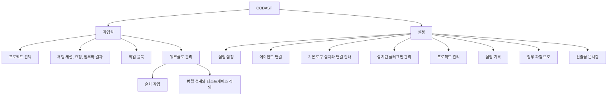
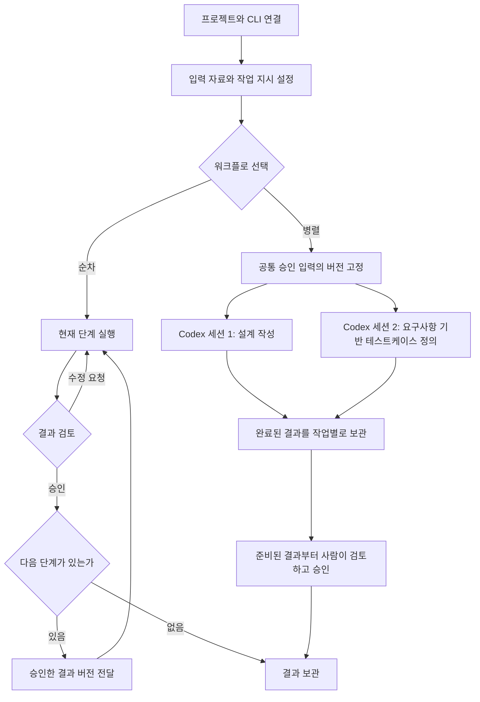

# CODAST

CODAST는 Codex와 Claude Code의 작업 지시, 자료, 결과와 실행 기록을 관리하는 개인용 로컬 작업 공간입니다.

## 프로젝트 목적

여러 AI에게 맡긴 작업의 입력 자료, 지시, 결정 사항과 결과를 프로젝트별로 연결하고, 중단 후에도 기록을 바탕으로 작업을 이어가는 것이 목적입니다. 사용자는 각 결과를 검토하고 수정 의견이나 승인을 남기며, 승인한 정확한 버전을 다음 작업에 전달합니다.

## 핵심 기능

- **작업과 세션 관리:** 프로젝트별 채팅과 실행 기록을 보관하고 스트리밍, 취소와 초안 복원을 지원합니다. 이전 CODAST, Codex, Claude 대화의 본문을 검색할 수 있습니다.
- **자료와 결과 관리:** 첨부 자료와 산출물 문서함에서 결과 버전, 검토와 승인 이력을 관리합니다. 문서 비교에서는 추가, 삭제, 수정한 줄을 강조합니다.
- **순차 작업 인계:** 단계별 AI와 지시를 설정하고 승인한 결과 버전을 다음 단계의 입력으로 전달합니다.
- **병렬 작업 관리:** 같은 승인 입력으로 별도 Codex 세션이 설계와 요구사항 기반 테스트케이스를 동시에 작성하며, 각 작업의 상태와 결과를 별도로 보관합니다.

## 설치와 실행

저장소를 내려받은 뒤 프로젝트 폴더에서 운영체제에 맞는 명령을 실행합니다. `start` 하나로 최초 설치와 서버 실행을 처리합니다.

현재 검증 범위는 Windows입니다. Linux, macOS용 실행기와 Homebrew 설치 방법도 제공하지만, 해당 환경에서의 실제 설치와 실행은 미검증입니다.

Windows:

```powershell
.\codast.cmd start
```

Linux, macOS:

```sh
sh ./codast.sh start
```

uv가 없으면 공식 설치 프로그램으로 프로젝트의 `.local/uv`에 설치합니다. Linux, macOS에서 uv를 자동 설치하려면 `curl` 또는 `wget`이 필요합니다. 새 환경에는 Python 3.12와 가상환경 `.venv`를 준비하고, 기존 환경은 프로젝트 요구사항에 맞는 Python 버전을 유지합니다. 이어서 `uv.lock`에 고정된 패키지를 설치하고 앱을 실행합니다. Python을 미리 설치하거나 가상환경을 직접 활성화할 필요가 없습니다. 최초 설치에는 인터넷 연결이 필요합니다. 설치가 중단되면 오류를 해결한 뒤 같은 명령을 다시 실행하면 됩니다.

Homebrew를 사용하는 macOS, Linux에서는 uv를 먼저 설치해도 됩니다. 실행기는 PATH에 있는 uv를 재사용하며, Homebrew를 자동으로 설치하거나 변경하지 않습니다.

```sh
brew install uv
sh ./codast.sh start
```

이는 [Homebrew의 uv 패키지](https://formulae.brew.sh/formula/uv)를 사용하는 방식이며 CODAST 자체의 Homebrew 패키지를 배포하는 것은 아닙니다.

공통 개발 도구까지 준비하려면 `init`, Python 테스트를 실행하려면 `test`를 사용합니다. 인수를 생략하면 `start`로 실행됩니다.

| 작업 | Windows | Linux, macOS |
| --- | --- | --- |
| 설치와 기본 개발 도구 준비 | `.\codast.cmd init` | `sh ./codast.sh init` |
| 실행 | `.\codast.cmd start` | `sh ./codast.sh start` |
| Python 테스트 | `.\codast.cmd test` | `sh ./codast.sh test` |

브라우저에서 http://127.0.0.1:8765 에 접속한 뒤 사용할 CLI를 연결하고 프로젝트를 등록합니다. 실제 AI 실행에는 Codex 또는 Claude Code CLI를 별도로 설치하고 로그인해야 합니다. 서버는 실행한 터미널에서 `Ctrl+C`로 종료합니다.

FastAPI 서버와 현재 HTML, JavaScript 화면은 별도 빌드 없이 실행합니다. `init`은 패키지와 기본 개발 도구 준비, `start`는 앱 패키지 준비와 서버 실행에 해당합니다. 운영체제별 앱 기능 지원 범위는 다를 수 있습니다.

설치 방식은 [uv 설치 문서](https://docs.astral.sh/uv/getting-started/installation/)와 [Python 자동 설치 안내](https://docs.astral.sh/uv/concepts/python-versions/)를 따릅니다. 실행기는 셸 설정이나 전역 PATH를 변경하지 않습니다. Windows 실행기는 PowerShell 실행 정책을 해당 프로세스에만 적용하며 시스템 정책을 변경하지 않습니다.

### init으로 설치하거나 연결하는 항목

Windows의 `.\codast.cmd init`, Linux와 macOS의 `sh ./codast.sh init`은 아래 항목을 준비합니다. 플러그인과 MCP 기본 목록은 [도구 카탈로그](app/defaults/tool-catalog.json)에서 관리합니다.

| 항목 | 용도 | 자동 준비 방식 |
| --- | --- | --- |
| uv | Python과 패키지 설치 | 기존 설치를 재사용하고, 없으면 `.local/uv`에 설치합니다. |
| Python, 가상환경 | CODAST 실행 환경 | 새 환경에는 Python 3.12와 `.venv`를 준비하고 기존 호환 환경은 재사용합니다. |
| CODAST 실행, 테스트 패키지 | 웹 서버, 자료 처리와 테스트 | [패키지 목록](pyproject.toml)을 [uv.lock](uv.lock)에 고정된 버전으로 `.venv`에 설치합니다. |
| [Superpowers](https://github.com/obra/superpowers) | 설계, 테스트, 디버깅과 검토 절차 | Claude와 Codex 각각의 설치 목록을 확인하고, 누락된 플러그인을 사용자 범위에 설치합니다. |
| [Ponytail](https://github.com/DietrichGebert/ponytail) | 기존 코드 재사용과 필요한 범위의 개발 규칙 | Claude와 Codex 각각의 설치 목록을 확인하고, 누락된 플러그인을 사용자 범위에 설치합니다. |
| [Serena 2.1.0](https://github.com/oraios/serena/releases/tag/v2.1.0) | 코드 심볼, 호출자와 참조 관계 탐색 | 고정 커밋을 `.local/serena` 전용 Python 환경에 한 번 설치하고 양쪽 CLI에 MCP 연결 설정을 전달합니다. |
| [Context7](https://github.com/upstash/context7) | 기술 버전별 개발 문서 조회 | 로컬 패키지 설치 없이 공식 원격 MCP 연결을 양쪽 CLI에 설정합니다. 별도 Node 설치나 초기 인증키 입력은 필요하지 않습니다. |

기존 플러그인의 버전과 꺼 둔 상태는 유지합니다. 사용자 범위에 새로 설치한 플러그인은 같은 컴퓨터의 다른 프로젝트에서도 적용됩니다. 마켓플레이스가 없으면 공개 배포 출처를 등록하고, 같은 이름의 출처가 다르거나 확인되지 않으면 덮어쓰지 않고 안내합니다. 같은 `init`을 다시 실행하면 준비된 설치를 확인해 재사용하고 불완전한 설치는 재시도합니다.

처음에는 인터넷과 Git이 필요합니다. **Claude Code CLI, Codex CLI와 Git 자체는 자동 설치하지 않습니다.** CLI는 별도로 설치하며, 기존 앱 설정에서 지정한 실행 경로를 재사용합니다. 지원하는 플러그인 명령이 없는 CLI는 업데이트가 필요합니다. Context7의 인증키 없는 연결에는 이용 한도가 적용될 수 있습니다.

### 필요할 때 별도로 연결하는 선택 도구

아래 항목은 `init`의 자동 설치 대상이 아닙니다. 기본 도구 화면에서 기존 설치 여부와 연결 안내를 확인하고, 필요한 서비스만 각 제공사의 절차에 따라 설치하거나 연결합니다.

| 항목 | 용도 | 설치와 연결 방식 |
| --- | --- | --- |
| GitHub | 저장소, 이슈와 PR 조회 및 작업 | 각 CLI에서 제공하는 GitHub 플러그인을 사용하고, 해당 계정 인증과 접근 권한을 별도로 설정합니다. |
| Notion | 팀 문서와 작업 자료 연결 | 각 CLI에서 제공하는 Notion 플러그인을 사용하고, 연결할 계정과 워크스페이스를 선택합니다. |
| 문서 작업 도구 | Word, PDF, 스프레드시트와 프레젠테이션 작업 | Codex는 기존 Documents, PDF, Spreadsheets, Presentations를 확인합니다. Claude는 공식 document-skills 안내를 따릅니다. 각 제공사의 실행 환경과 이용 조건을 따르며 다른 제품으로 복사하지 않습니다. |

### 설치 상태 확인과 로그인

설정의 **기본 도구** 화면에서도 누락된 기본 도구를 설치하고, 양쪽 CLI 상태를 검색과 필터로 확인할 수 있습니다. 전체 설치 플러그인은 기존 **플러그인** 화면에서 관리합니다. 프로젝트별 설치는 해당 프로젝트의 플러그인 화면에서 확인하며 공통 사용자 설치와 구분합니다.

`init`과 상태 조회는 로그인 창을 열지 않습니다. CLI 로그인은 **에이전트 연결**, 개별 서비스 인증은 선택한 도구의 **연결 안내**에서 하나씩 진행합니다. 인증정보를 CODAST에 저장하거나 Claude와 Codex 사이에 복사하지 않습니다. 설치됨, 꺼짐, CLI 인증 확인, 서비스 인증 미확인과 실제 실행 미검증은 별도로 표시합니다. Codex에서 플러그인 훅을 사용하려면 `/hooks`에서 출처와 신뢰 상태를 확인해야 할 수 있습니다. 한 항목의 설치가 실패해도 나머지를 확인하며, 실패한 항목은 안내를 해결한 뒤 다시 설치할 수 있습니다.

MCP 실행 환경은 한 번 설치하고, CODAST가 Claude와 Codex를 실행할 때 각 CLI 형식에 맞는 연결 설정을 전달합니다. 새 실행과 대화 재개에 모두 적용되며, 개인 전역 설정과 대상 저장소의 MCP 설정을 덮어쓰지 않습니다. CLI 설치와 로그인은 기존 에이전트 연결 화면에서 별도로 완료해야 합니다. `init`의 설치 완료는 실제 MCP 연결이나 프로젝트 분석 성공을 의미하지 않습니다.

Serena는 심볼과 참조 관계를 읽는 탐색 도구만 제공합니다. 실제 코드 수정은 기존 Claude, Codex 권한 경로를 따릅니다. Context7으로 기술 문서를 확인한 뒤 구현하고, 기존 기능과 연결을 검토하는 지침도 함께 전달합니다. 프로젝트의 Serena 설정이 REPL 전용이거나 필수 탐색 도구를 제외하면 연결이 실패하므로 tools 인터페이스와 탐색 도구 설정을 확인하세요. 별도 그래프 화면은 필요하지 않습니다.

Spring 프로젝트는 Java, Maven 또는 Gradle 환경이 정상이어야 합니다. 최초 분석 시 언어 서버 다운로드와 색인 시간이 추가될 수 있습니다. Serena는 자체 sandbox가 아니며 프로젝트 `.serena`에 설정과 캐시를 만들 수 있습니다. Spring의 런타임 빈 연결과 AOP 동작은 기존 빌드와 통합 테스트로 검증해야 합니다.

MCP 연결 구성은 CODAST가 실행하는 CLI에 적용됩니다. 기본 플러그인은 각 CLI의 사용자 설치로 등록하지만 데스크톱 앱 전용 도구를 다른 제품에 일괄 복제하지 않습니다. 문서 도구도 각 제공사의 실행 환경과 이용 조건을 따릅니다. 기존 플러그인은 각 CLI의 설치 상태와 관리 정책을 따릅니다. `start`와 `test`만 실행하면 기본 플러그인이나 새 MCP를 설치하지 않으며, 초기화 전 기존 동작을 유지합니다.

## 화면 구조 (IA)

작업실에서 요청과 결과를 확인하고, 설정에서 실행 환경과 자료 보관을 관리합니다. 아래는 주요 화면과 기능의 관계입니다.



## 작업 흐름

일반 채팅에서는 지시를 보내고 실행 결과를 확인합니다. 워크플로에서는 입력 자료와 작업을 설정한 뒤 결과를 검토하고 승인합니다.



병렬 테스트케이스 정의는 설계 결과를 기다리지 않습니다. 질문, 실패와 취소는 작업별로 처리하며 완료된 다른 결과는 유지합니다.

## 이전 대화 검색

프로젝트를 선택한 뒤 채팅 목록의 **대화 검색**을 누릅니다. CODAST 대화와 같은 프로젝트 경로에 저장된 Codex, Claude 세션의 사용자 메시지, 답변을 읽어 이 컴퓨터에 검색 색인을 만듭니다. 아직 CODAST에 연결하지 않은 세션과 보관된 Codex 세션도 포함합니다. AI 실행이나 외부 전송은 하지 않습니다.

기억나는 단어나 문장을 입력하면 일치하는 본문과 세션이 표시됩니다. 띄어 쓴 검색어는 모두 포함된 메시지를 찾으며, 두 글자 한글과 단어 일부도 검색할 수 있습니다. **대화 보기**에서 검색한 메시지와 앞뒤 대화를 확인하고, CODAST 결과는 **이 채팅으로 이동**으로 해당 기록을 엽니다. Codex, Claude 결과는 내용을 확인한 뒤 **이 세션 연결하기**로 기존 연결 절차를 열 수 있습니다.

검색 창을 열면 변경된 기록을 다시 읽습니다. 열린 상태에서 새 대화가 생기면 **기록 새로 읽기**를 누르세요. 첫 색인은 기록량에 따라 시간이 걸리며, 읽는 중에도 준비된 내용부터 검색합니다. 일부 기록을 읽지 못하면 화면에 실패한 에이전트와 안내를 표시하고, 이미 만들어 둔 색인은 유지합니다. 검색 결과와 대화 보기는 마지막으로 읽은 기록을 기준으로 합니다.

검색 색인은 실행 DB 옆의 별도 `*-session-search.sqlite3` 파일에 저장됩니다. 이 파일에도 대화 본문이 있으므로 실행 DB와 같은 수준으로 관리하세요. 첨부 이미지, 내부 추론과 도구 실행 내용, CODAST가 삽입한 규칙과 참고 자료는 본문 검색에서 제외합니다. 최근 미리보기의 메시지 수와 8,000자 제한은 검색에 적용하지 않지만, Codex는 한 세션 조회 응답이 128 MiB를 넘거나 CLI 조회가 시간 안에 끝나지 않으면 해당 세션을 색인하지 못하고 안내를 표시합니다.

## 문서 변경 비교

산출물 문서함에서 검토할 버전을 선택하면 직전 승인본과 제목, 본문을 비교합니다. 추가, 삭제, 수정 전과 수정 후를 색상과 텍스트로 구분하며 원문의 공백과 개행을 유지합니다. 첫 버전은 전체를 추가로 표시합니다. 변경 구간이 매우 크면 화면 정지를 막기 위해 구간을 묶어 표시하고 그 사실을 안내합니다.

## 첨부 자료

첨부 파일은 로컬에서 텍스트를 추출하고 보호 설정을 적용한 뒤 Markdown으로 보관합니다. 긴 자료에 대한 구체적인 질문은 관련 부분을 발췌해 AI 입력량을 줄입니다. 일반 본문은 같은 제목 아래의 문단과 표를 함께 전달하며, 제목 경계를 확인할 수 없으면 전체 전달로 돌아갑니다. 표 검색은 해당 행과 열 제목을 함께 전달합니다. 별도 검색 설정이나 수동 보정은 필요하지 않습니다. 보낸 메시지의 첨부를 열면 선택된 내용과 전달 문자 수를 확인할 수 있습니다. 문자 수 감소율은 실제 토큰 수나 요금 감소율과 다릅니다.

PDF는 관련 페이지 전체, PowerPoint는 관련 슬라이드 전체의 추출된 텍스트를 함께 보냅니다. 발췌에 요구사항 코드가 있으면 같은 자료에서 확인한 정의와 그 정의가 참조하는 요구사항까지 포함합니다. 특정 요구사항 코드를 지정하지 않은 키워드나 수치 질문은 서로 다른 요구사항의 적용 범위를 확정할 수 없어 전체 전달합니다. 참조 정의가 없거나 중복되거나, 앞 절, 별첨처럼 대상을 확정할 수 없는 참조도 전체 전달로 돌아갑니다. 요구사항 참조를 모두 포함해도 생략할 본문이 남으면 그 본문에 추가 조건이 없는지 입증할 수 없으므로 전체 전달합니다. 짧은 자료, 전체 요약, 분석, 집계, 구현 요청과 워크플로도 전체 내용을 유지합니다. 검색 근거가 부족하거나 참조를 포함한 범위가 발췌 예산을 넘을 때도 전체 전달합니다. 전체 내용이 입력 한도를 넘으면 임의로 자르거나 일부 자료를 생략하지 않고 현재 입력 크기와 한도를 표시하며 자료를 나누도록 안내합니다. 기존에 보관한 자료도 사용할 수 있지만, 페이지 구분 없이 저장된 이전 PDF와 PowerPoint는 전체 전달하며 발췌하려면 다시 첨부해야 합니다. 이미지 속 글자의 OCR, PowerPoint 발표자 노트, HWP는 지원하지 않습니다.

## 개발

```powershell
uv run python -m pytest -q
```

개발 규칙은 [AGENTS.md](AGENTS.md), 작업 요청 양식은 [작업 지시서 예시](docs/task-request-example.md)를 참고하세요.
