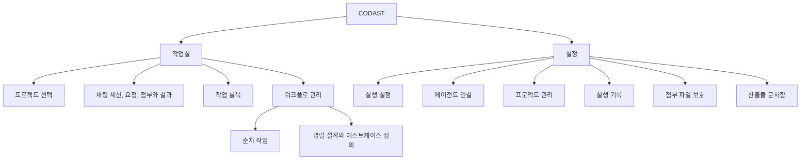
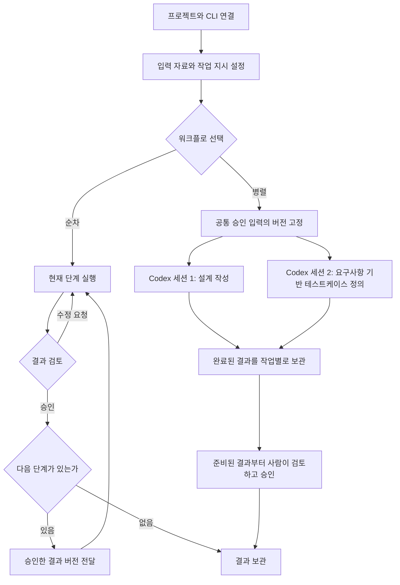

# CODAST

CODAST는 Codex와 Claude Code의 작업 지시, 자료, 결과와 실행 기록을 관리하는 개인용 로컬 작업 공간입니다.

## 프로젝트 목적

여러 AI에게 맡긴 작업의 입력 자료, 지시, 결정 사항과 결과를 프로젝트별로 연결하고, 중단 후에도 기록을 바탕으로 작업을 이어가는 것이 목적입니다. 사용자는 각 결과를 검토하고 수정 의견이나 승인을 남기며, 승인한 정확한 버전을 다음 작업에 전달합니다.

## 핵심 기능

- **작업과 세션 관리:** 프로젝트별 채팅과 실행 기록을 보관하고 스트리밍, 취소와 초안 복원을 지원합니다.
- **자료와 결과 관리:** 첨부 자료와 산출물 문서함에서 결과 버전, 검토와 승인 이력을 관리합니다.
- **순차 작업 인계:** 단계별 AI와 지시를 설정하고 승인한 결과 버전을 다음 단계의 입력으로 전달합니다.
- **병렬 작업 관리:** 같은 승인 입력으로 별도 Codex 세션이 설계와 요구사항 기반 테스트케이스를 동시에 작성하며, 각 작업의 상태와 결과를 별도로 보관합니다.

## 설치와 실행

Python 3.12 이상과 uv가 필요합니다. 실제 AI 실행에는 사용할 Codex 또는 Claude Code CLI를 별도로 설치하고 인증해야 합니다.

```powershell
uv sync
uv run python start.py
```

브라우저에서 http://127.0.0.1:8765 에 접속한 뒤 사용할 CLI를 연결하고 프로젝트를 등록합니다.

## 화면 구조 (IA)

작업실에서 요청과 결과를 확인하고, 설정에서 실행 환경과 자료 보관을 관리합니다. 아래는 주요 화면과 기능의 관계입니다.



## 작업 흐름

일반 채팅에서는 지시를 보내고 실행 결과를 확인합니다. 워크플로에서는 입력 자료와 작업을 설정한 뒤 결과를 검토하고 승인합니다.



병렬 테스트케이스 정의는 설계 결과를 기다리지 않습니다. 질문, 실패와 취소는 작업별로 처리하며 완료된 다른 결과는 유지합니다.

## 첨부 자료

첨부 파일은 로컬에서 텍스트를 추출하고 보호 설정을 적용한 뒤 Markdown으로 보관합니다. 긴 자료에 대한 구체적인 질문은 관련 부분을 발췌해 AI 입력량을 줄입니다. 일반 본문은 같은 제목 아래의 문단과 표를 함께 전달하며, 제목 경계를 확인할 수 없으면 전체 전달로 돌아갑니다. 표 검색은 해당 행과 열 제목을 함께 전달합니다. 별도 검색 설정이나 수동 보정은 필요하지 않습니다. 보낸 메시지의 첨부를 열면 선택된 내용과 전달 문자 수를 확인할 수 있습니다. 문자 수 감소율은 실제 토큰 수나 요금 감소율과 다릅니다.

PDF는 관련 페이지 전체, PowerPoint는 관련 슬라이드 전체의 추출된 텍스트를 함께 보냅니다. 다른 페이지나 섹션을 참조하는 조건까지 자동으로 찾아 보존하는 것은 아닙니다. 짧은 자료, 전체 요약, 분석, 집계, 구현 요청과 워크플로는 전체 내용을 유지합니다. 검색 근거가 부족하거나 관련 범위가 발췌 예산을 넘을 때도 전체 전달로 돌아갑니다. 전체 내용이 입력 한도를 넘으면 임의로 자르지 않고 범위를 줄여 달라는 오류를 표시합니다. 기존에 보관한 자료도 사용할 수 있지만, 페이지 구분 없이 저장된 이전 PDF와 PowerPoint는 전체 전달하며 발췌하려면 다시 첨부해야 합니다. 이미지 속 글자의 OCR, PowerPoint 발표자 노트, HWP는 지원하지 않습니다.

## 개발

```powershell
uv run python -m pytest -q
```

개발 규칙은 [AGENTS.md](AGENTS.md), 작업 요청 양식은 [작업 지시서 예시](docs/task-request-example.md)를 참고하세요.
