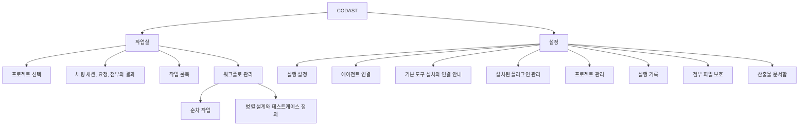
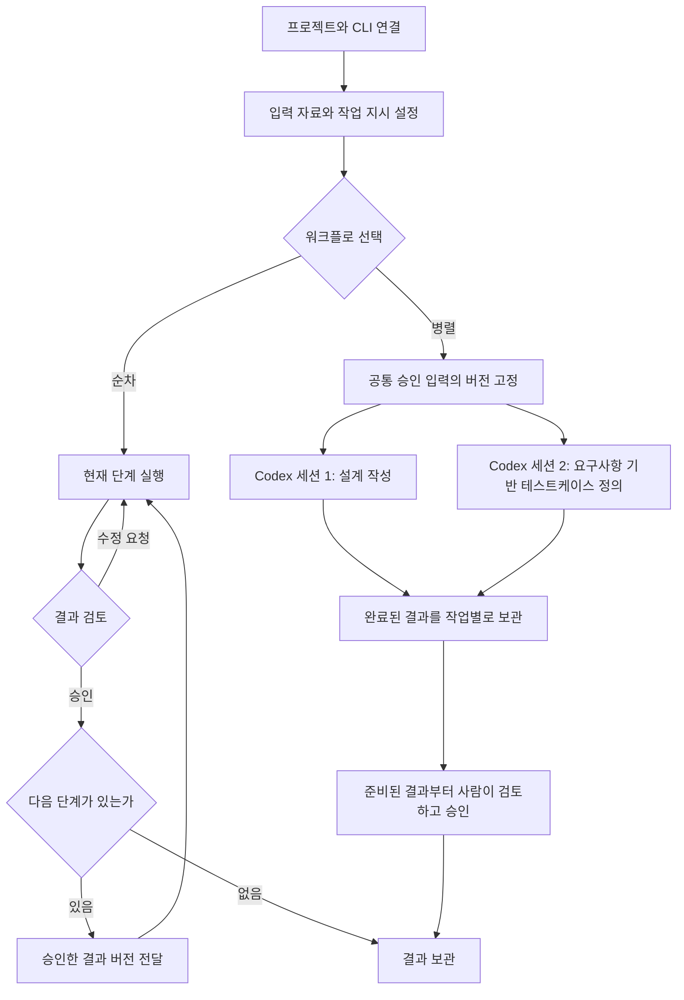

# CODAST

CODAST는 Codex와 Claude Code에 맡긴 작업의 지시, 자료, 결과와 실행 기록을 프로젝트별로 관리하는 개인용 로컬 작업 공간이다. 여러 AI가 수행한 작업을 연결하고, 작업이 중단된 뒤에도 이전 기록을 바탕으로 이어갈 수 있도록 만든 도구다. 사용자는 결과를 검토해 수정 의견이나 승인을 남기고, 승인한 버전을 다음 작업의 입력으로 전달할 수 있다.

프로젝트별 채팅과 실행 기록은 함께 보관되며, 응답 스트리밍, 실행 취소와 작성 중인 초안 복원을 지원한다. 이전 CODAST, Codex, Claude 대화는 본문 검색으로 찾을 수 있고, 첨부 자료와 산출물은 문서함에서 결과 버전, 검토와 승인 이력을 관리한다. 문서가 바뀌면 이전 버전과 비교해 추가, 삭제, 수정한 줄을 확인할 수 있다.

여러 단계로 진행하는 작업은 워크플로로 구성한다. 순차 작업에서는 단계별 AI와 지시를 정하고 승인한 결과 버전을 다음 단계에 넘기며, 병렬 작업에서는 공통으로 승인된 입력을 받은 각각의 Codex 세션이 설계와 요구사항 기반 테스트케이스를 동시에 작성한다. 각 작업의 진행 상태와 결과는 개별적으로 보관된다.

## 설치와 실행

저장소를 내려받은 뒤 프로젝트 폴더에서 `start` 명령을 실행하면 CODAST에 필요한 패키지를 준비하고 서버를 시작한다. 현재 설치와 실행을 검증한 운영체제는 Windows이며, Linux와 macOS용 실행기와 Homebrew 설치 방법도 제공하지만 해당 환경에서의 실제 동작은 아직 검증하지 않았다.

Windows에서는 다음 명령으로 실행한다.

```powershell
.\codast.cmd start
```

Linux와 macOS에서는 셸 실행기를 사용한다.

```sh
sh ./codast.sh start
```

실행기는 기존 uv 설치를 사용하며, uv가 없으면 공식 설치 프로그램을 통해 프로젝트의 `.local/uv`에 설치한다. 새 환경에는 Python 3.12와 가상환경 `.venv`를 준비하고, 기존 환경에서는 프로젝트 요구사항에 맞는 Python 버전을 유지한다. 이후 `uv.lock`에 고정된 패키지를 설치하고 앱을 실행하므로 Python 사전 설치나 가상환경의 수동 활성화는 필요하지 않다. 최초 설치에는 인터넷 연결이 필요하며, Linux와 macOS에서 uv를 자동 설치할 때는 `curl` 또는 `wget`도 필요하다. 설치가 중단된 경우에는 오류를 해결한 뒤 같은 명령으로 다시 실행할 수 있다.

Homebrew를 사용하는 macOS와 Linux에서는 uv를 먼저 설치한 뒤 CODAST를 실행할 수도 있다.

```sh
brew install uv
sh ./codast.sh start
```

이 방식은 [Homebrew의 uv 패키지](https://formulae.brew.sh/formula/uv)를 이용한다. CODAST 실행기는 PATH에 있는 uv를 재사용하며 Homebrew 자체를 설치하거나 변경하지 않는다. CODAST용 Homebrew 패키지는 별도로 배포하지 않는다.

실행 명령은 개발 도구 준비를 위한 `init`, 서버를 시작하는 `start`, Python 테스트를 실행하는 `test`로 나뉘며, 인수를 생략하면 `start`가 적용된다.

| 작업 | Windows | Linux, macOS |
| --- | --- | --- |
| 설치와 기본 개발 도구 준비 | `.\codast.cmd init` | `sh ./codast.sh init` |
| 실행 | `.\codast.cmd start` | `sh ./codast.sh start` |
| Python 테스트 | `.\codast.cmd test` | `sh ./codast.sh test` |

서버가 시작되면 브라우저의 http://127.0.0.1:8765 에서 사용할 CLI를 연결하고 프로젝트를 등록할 수 있다. 실제 AI 실행에는 별도로 설치하고 로그인한 Codex 또는 Claude Code CLI가 필요하며, 서버는 실행한 터미널에서 `Ctrl+C`로 종료한다.

FastAPI 서버와 HTML, JavaScript 화면은 별도 빌드 없이 실행된다. `start`와 `test`는 앱 실행과 검증에 필요한 패키지를 준비하고 기본 플러그인이나 새 MCP를 설치하지 않으므로, 개발 도구를 초기화하기 전의 동작을 유지한다. 앱 기능의 지원 범위는 운영체제에 따라 다를 수 있다.

설치는 [uv 설치 문서](https://docs.astral.sh/uv/getting-started/installation/)와 [Python 자동 설치 안내](https://docs.astral.sh/uv/concepts/python-versions/)에 따른다. 실행기는 셸 설정이나 전역 PATH를 변경하지 않으며, Windows의 PowerShell 실행 정책도 해당 프로세스에만 적용해 시스템 정책을 유지한다.

### 개발 도구 설치와 연결

Windows의 `.\codast.cmd init`, Linux와 macOS의 `sh ./codast.sh init`은 CODAST 패키지와 함께 공통 개발 도구를 준비한다. 기본 플러그인과 MCP 목록은 [도구 카탈로그](app/defaults/tool-catalog.json)에서 관리하며, 설치하거나 연결하는 항목은 다음과 같다.

| 항목 | 용도 | 자동 준비 방식 |
| --- | --- | --- |
| uv | Python과 패키지 설치 | 기존 설치를 재사용하고, 없으면 `.local/uv`에 설치한다. |
| Python, 가상환경 | CODAST 실행 환경 | 새 환경에는 Python 3.12와 `.venv`를 준비하고 기존 호환 환경은 재사용한다. |
| CODAST 실행, 테스트 패키지 | 웹 서버, 자료 처리와 테스트 | [패키지 목록](pyproject.toml)을 [uv.lock](uv.lock)에 고정된 버전으로 `.venv`에 설치한다. |
| [Superpowers](https://github.com/obra/superpowers) | 설계, 테스트, 디버깅과 검토 절차 | Claude와 Codex 각각의 설치 목록을 확인하고, 누락된 플러그인을 사용자 범위에 설치한다. |
| [Ponytail](https://github.com/DietrichGebert/ponytail) | 기존 코드 재사용과 필요한 범위의 개발 규칙 | Claude와 Codex 각각의 설치 목록을 확인하고, 누락된 플러그인을 사용자 범위에 설치한다. |
| [Serena 2.1.0](https://github.com/oraios/serena/releases/tag/v2.1.0) | 코드 심볼, 호출자와 참조 관계 탐색 | 고정 커밋을 `.local/serena` 전용 Python 환경에 한 번 설치하고 양쪽 CLI에 MCP 연결 설정을 전달한다. |
| [Context7](https://github.com/upstash/context7) | 기술 버전별 개발 문서 조회 | 로컬 패키지 설치 없이 공식 원격 MCP 연결을 양쪽 CLI에 설정하며, 별도 Node 설치나 초기 인증키 입력은 필요하지 않다. |

`init`은 기존 플러그인의 버전과 비활성 상태를 유지하고, 새 플러그인은 사용자 범위에 설치한다. 이 범위에 설치된 플러그인은 같은 컴퓨터의 다른 프로젝트에도 적용된다. 마켓플레이스가 없으면 공개 배포 출처를 등록하지만, 같은 이름의 출처가 다르거나 확인되지 않는 경우에는 덮어쓰지 않고 그 상태를 안내한다. `init`을 다시 실행하면 준비된 설치를 재사용하고 불완전한 설치는 다시 시도한다.

최초 준비에는 인터넷과 Git이 필요하며, **Claude Code CLI, Codex CLI와 Git 자체는 자동 설치 대상이 아니다.** 실행기는 앱 설정에 지정된 CLI 경로를 재사용하므로 CLI는 별도로 설치되어 있어야 하고, 플러그인 명령을 지원하지 않는 버전은 업데이트가 필요하다. Context7을 인증키 없이 연결하면 이용 한도가 적용될 수 있다.

GitHub, Notion과 문서 작업 도구는 필요에 따라 별도로 연결하는 선택 도구다. `init`은 이 도구들을 자동 설치하지 않으며, **기본 도구** 화면에서 기존 설치 여부와 제공사별 연결 절차를 확인할 수 있다.

| 항목 | 용도 | 설치와 연결 방식 |
| --- | --- | --- |
| GitHub | 저장소, 이슈와 PR 조회 및 작업 | 각 CLI의 GitHub 플러그인을 사용하며, 계정 인증과 접근 권한은 별도로 설정한다. |
| Notion | 팀 문서와 작업 자료 연결 | 각 CLI의 Notion 플러그인에서 연결할 계정과 워크스페이스를 선택한다. |
| 문서 작업 도구 | Word, PDF, 스프레드시트와 프레젠테이션 작업 | Codex는 기존 Documents, PDF, Spreadsheets, Presentations를 확인하고 Claude는 공식 document-skills 안내를 따른다. 도구는 각 제공사의 실행 환경과 이용 조건에 따라 사용하며 다른 제품으로 복사하지 않는다. |

### 설치 상태 확인과 로그인

설정의 **기본 도구** 화면에서는 누락된 기본 도구를 설치하고 검색과 필터로 양쪽 CLI의 상태를 확인할 수 있다. 전체 설치 목록은 **플러그인** 화면에서 관리하며, 프로젝트별 설치는 해당 프로젝트 화면에서 공통 사용자 설치와 구분해 표시한다.

`init`이나 상태 조회만으로는 로그인 창이 열리지 않는다. CLI 로그인은 **에이전트 연결**에서, 개별 서비스 인증은 선택한 도구의 **연결 안내**에서 진행하며, 인증정보를 CODAST에 저장하거나 Claude와 Codex 사이에 복사하지 않는다. 화면에는 설치됨, 꺼짐, CLI 인증 확인, 서비스 인증 미확인과 실제 실행 미검증을 구분해 표시한다. 한 항목의 설치가 실패해도 나머지 항목의 확인은 계속되고, 실패한 항목은 원인을 해결한 뒤 다시 설치할 수 있다. Codex의 플러그인 훅은 `/hooks`에서 출처와 신뢰 상태를 추가로 확인해야 할 수 있다.

MCP 실행 환경은 한 번 설치한 뒤 재사용하며, CODAST가 Claude와 Codex를 실행할 때 각 CLI 형식에 맞는 연결 설정을 전달한다. 이 설정은 새 실행과 대화 재개에 모두 적용되지만 개인 전역 설정이나 대상 저장소의 MCP 설정을 덮어쓰지는 않는다. 연결 구성의 적용 범위는 CODAST가 실행하는 CLI이며, 기본 플러그인은 각 CLI의 사용자 설치로 등록된다. 데스크톱 앱 전용 도구를 다른 제품에 일괄 복제하지 않으며 기존 플러그인은 해당 CLI의 설치 상태와 관리 정책을 따른다. `init`이 설치를 마쳤더라도 CLI 설치와 로그인이 별도로 필요하고, 실제 MCP 연결과 프로젝트 분석의 성공 여부는 실행을 통해 확인해야 한다.

Serena 연결에서는 심볼과 참조 관계를 읽는 탐색 도구만 제공하고, 실제 코드 수정에는 기존 Claude, Codex 권한을 적용한다. Context7으로 기술 문서를 확인한 뒤 구현하고 기존 기능과 연결을 검토하도록 하는 지침도 CLI에 함께 전달한다. Serena는 별도 그래프 화면 없이 사용할 수 있지만, 프로젝트 설정이 REPL 전용이거나 필수 탐색 도구를 제외한 경우에는 연결이 실패하므로 tools 인터페이스와 탐색 도구 설정이 필요하다.

Spring 프로젝트를 분석하려면 Java와 Maven 또는 Gradle 환경이 정상적으로 구성되어 있어야 하며, 최초 분석에는 언어 서버 다운로드와 색인 시간이 추가될 수 있다. Serena는 자체 sandbox가 아니며 프로젝트의 `.serena`에 설정과 캐시를 만들 수 있다. 또한 심볼 탐색만으로 Spring의 런타임 빈 연결과 AOP 동작을 확인할 수는 없어, 해당 동작은 기존 빌드와 통합 테스트로 검증해야 한다.

## 화면 구조 (IA)

화면은 요청과 결과를 다루는 작업실과 실행 환경, 자료 보관을 관리하는 설정으로 나뉜다. 작업실에는 프로젝트 선택, 채팅, 작업 룰북과 워크플로가 있고, 설정에는 에이전트와 도구 연결, 실행 기록, 첨부 파일 보호와 산출물 관리 기능이 배치되어 있다.



## 작업 흐름

일반 채팅은 지시를 보내고 실행 결과를 확인하는 흐름이며, 워크플로는 입력 자료와 작업을 정한 뒤 결과를 검토하고 승인하는 흐름이다. 순차 작업은 현재 단계의 결과가 승인되면 해당 버전을 다음 단계에 전달하고, 병렬 작업은 공통으로 승인된 입력을 기준으로 각 작업을 독립적으로 진행한다.



병렬 작업의 테스트케이스 정의는 설계 결과를 기다리지 않으며, 완료된 결과부터 사람이 검토하고 승인할 수 있다. 질문, 실패와 취소도 작업별로 처리하므로 한 작업의 상태가 바뀌더라도 다른 작업에서 이미 완료한 결과는 유지된다.

## 이전 대화 검색

채팅 목록의 **대화 검색**은 선택한 프로젝트의 CODAST 대화와 같은 프로젝트 경로에 저장된 Codex, Claude 세션을 함께 검색하는 기능이다. 사용자 메시지와 답변을 읽어 로컬 검색 색인을 만들며, 아직 CODAST에 연결하지 않은 세션과 보관된 Codex 세션도 포함한다. 이 과정에서 AI를 실행하거나 대화 내용을 외부로 전송하지 않는다.

검색어를 입력하면 일치하는 본문과 세션이 표시된다. 여러 검색어를 띄어 쓰면 모든 검색어를 포함한 메시지를 찾으며, 두 글자 한글이나 단어 일부로도 검색할 수 있다. **대화 보기**에서는 검색한 메시지와 앞뒤 대화를 확인하고, CODAST 기록은 **이 채팅으로 이동**으로 열 수 있다. Codex와 Claude 기록은 내용을 확인한 뒤 **이 세션 연결하기**로 기존 연결 절차를 진행할 수 있다.

검색 창을 열 때는 변경된 기록을 다시 읽고, 창이 열린 상태에서 생긴 대화는 **기록 새로 읽기**로 반영한다. 첫 색인에는 기록량에 따라 시간이 걸릴 수 있지만 읽기가 끝난 내용부터 검색할 수 있다. 일부 기록을 읽지 못한 경우에는 해당 에이전트와 원인을 화면에 표시하고 기존 색인은 유지한다. 검색 결과와 대화 보기는 마지막으로 읽은 기록을 기준으로 표시된다.

색인은 실행 DB 옆의 `*-session-search.sqlite3` 파일에 저장된다. 대화 본문을 포함하므로 실행 DB와 같은 수준의 보호가 필요한 파일이다. 첨부 이미지, 내부 추론, 도구 실행 내용, CODAST가 삽입한 규칙과 참고 자료는 본문 검색에서 제외한다. 최근 미리보기의 메시지 수와 8,000자 제한은 검색에 적용하지 않지만, Codex의 한 세션 조회 응답이 128 MiB를 넘거나 CLI 조회가 제한 시간 안에 끝나지 않으면 해당 세션은 색인하지 못하고 안내를 표시한다.

## 문서 변경 비교

산출물 문서함은 선택한 버전의 제목과 본문을 직전 승인본과 비교해 보여준다. 추가와 삭제, 수정 전후를 색상과 텍스트로 구분하면서 원문의 공백과 개행을 유지하며, 비교 대상이 없는 첫 버전은 전체를 추가된 내용으로 표시한다. 변경 구간이 매우 큰 경우에는 화면이 멈추지 않도록 구간을 묶어 표시하고 그 사실을 안내한다.

## 첨부 자료

첨부 파일은 로컬에서 텍스트를 추출하고 보호 설정을 적용한 뒤 Markdown으로 보관한다. 긴 자료에 대한 구체적인 질문이 들어오면 관련 부분을 발췌해 AI에 전달하는 입력량을 줄인다. 일반 본문은 같은 제목 아래의 문단과 표를 묶어 전달하고, 표 검색은 해당 행과 열 제목을 함께 전달한다. PDF는 관련 페이지 전체, PowerPoint는 관련 슬라이드 전체에서 추출한 텍스트를 포함한다. 이 과정에는 별도 검색 설정이나 수동 보정이 필요하지 않으며, 보낸 메시지의 첨부에서 선택된 내용과 전달 문자 수를 확인할 수 있다. 다만 문자 수의 감소율이 실제 토큰 수나 요금의 감소율과 같지는 않다.

발췌한 내용에 요구사항 코드가 있으면 같은 자료에 있는 정의와 그 정의가 참조하는 요구사항까지 포함한다. 특정 코드를 지정하지 않은 키워드나 수치 질문은 서로 다른 요구사항의 적용 범위를 확정하기 어려워 전체 자료를 전달한다. 참조 정의가 없거나 중복된 경우, 앞 절이나 별첨처럼 참조 대상을 확정할 수 없는 경우에도 전체를 전달한다. 요구사항 참조를 모두 포함했더라도 생략할 본문에 추가 조건이 없다는 점을 입증할 수 없다면 발췌하지 않는다.

제목 경계를 확인할 수 없거나 검색 근거가 부족한 경우, 참조를 포함한 내용이 발췌 예산을 넘는 경우에도 전체 자료를 사용한다. 짧은 자료와 전체 요약, 분석, 집계, 구현 요청, 워크플로 역시 전체 내용을 유지한다. 전체 입력이 한도를 넘으면 내용을 임의로 자르거나 일부 자료를 생략하지 않고, 현재 입력 크기와 한도를 표시해 자료를 나눌 수 있도록 안내한다.

기존에 보관한 자료도 사용할 수 있지만, 페이지 구분 없이 저장된 이전 PDF와 PowerPoint는 전체 전달만 가능하므로 발췌하려면 다시 첨부해야 한다. 이미지 속 글자의 OCR, PowerPoint 발표자 노트와 HWP는 지원하지 않는다.

## 개발

Python 테스트는 프로젝트 폴더에서 다음 명령으로 실행한다.

```powershell
uv run python -m pytest -q
```

저장소의 개발 규칙은 [AGENTS.md](AGENTS.md)에 정리되어 있으며, 작업 요청에 필요한 내용과 작성 형식은 [작업 지시서 예시](docs/task-request-example.md)에서 확인할 수 있다.
